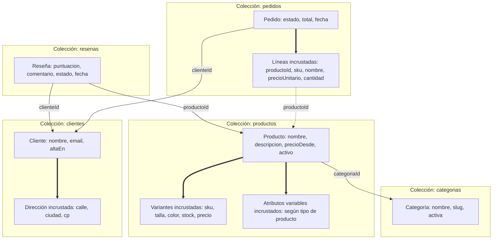
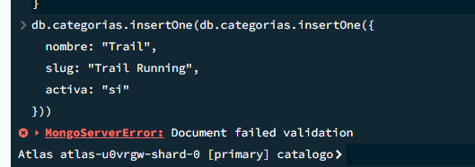
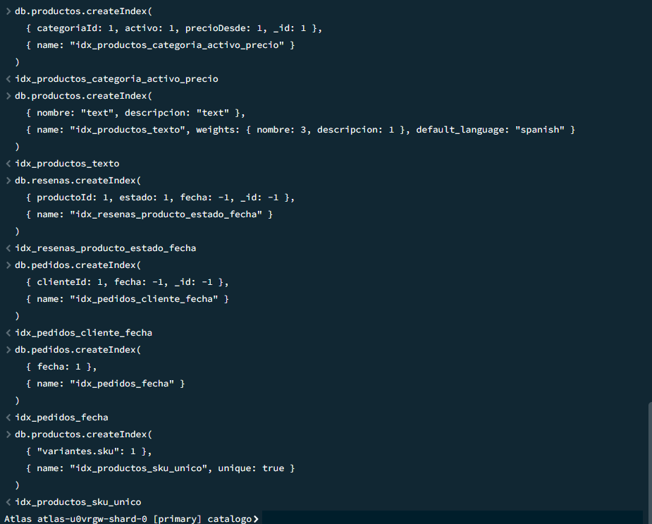
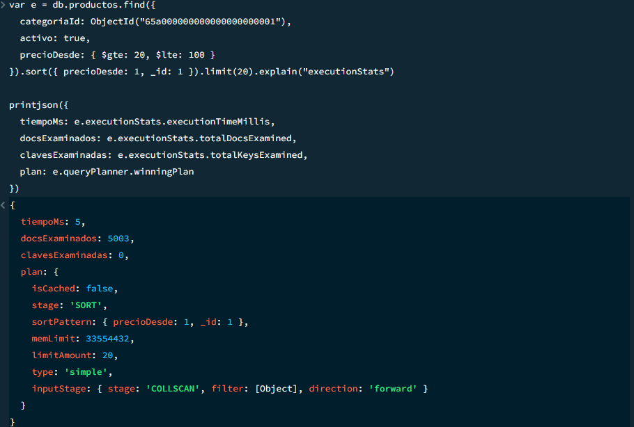
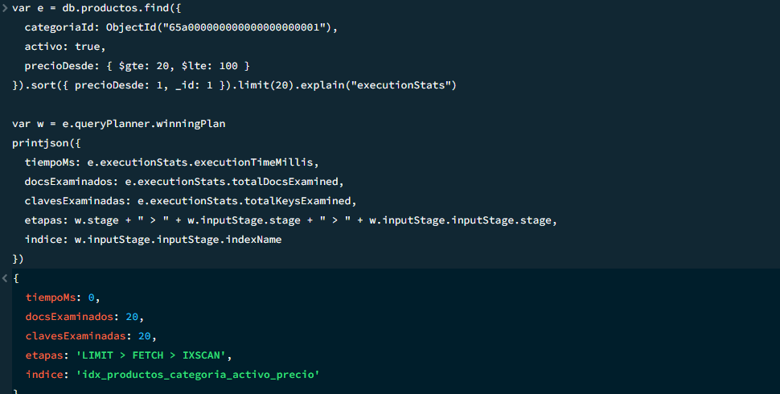
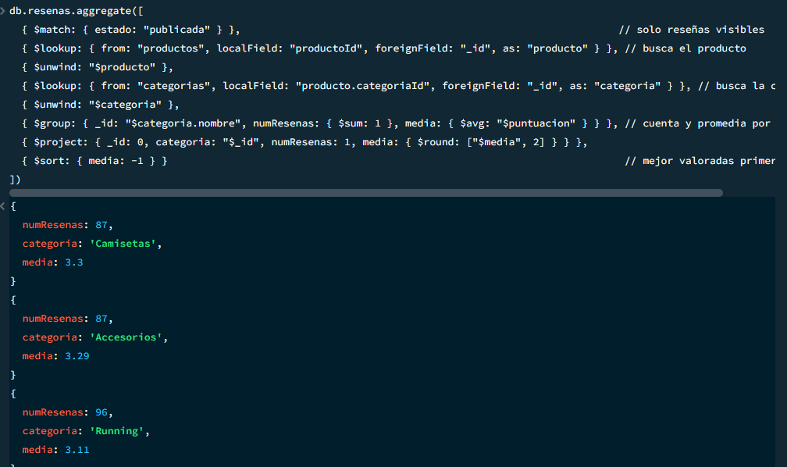
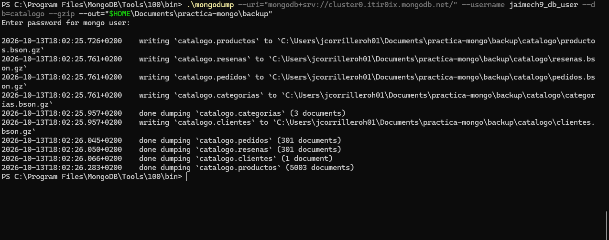
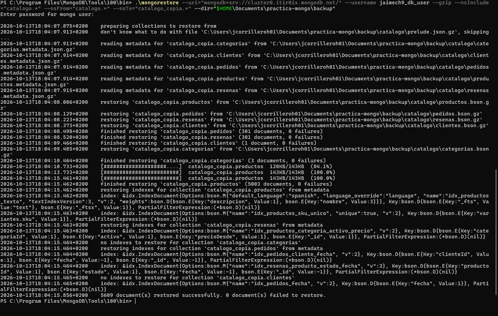

# Modelo de datos — Catálogo de comercio electrónico

## 1. Definir el problema y los accesos

### 1.1 Escenario y usuarios

Tienda online de ropa y calzado deportivo con un catálogo de **estructura variable** (cada tipo de producto tiene atributos distintos) y productos con **variantes** (talla y color, cada una con SKU, precio y stock). Los clientes dejan reseñas y hacen pedidos. MongoDB encaja porque no hay un esquema fijo de atributos y el catálogo se lee mucho más de lo que se escribe.

| Usuario | Acciones |
|---|---|
| Cliente | Navega, filtra, busca, lee y escribe reseñas, compra |
| Gestor de catálogo | Altas, cambios de precio, desactivación de productos |
| Almacén | Consulta stock bajo y repone |
| Comercial | Informes de ventas y valoraciones (solo lectura) |
| Administrador | Usuarios, copias de seguridad, índices |

### 1.2 Preguntas de negocio

| # | Pregunta |
|---|---|
| P1 | ¿Qué productos activos de una categoría hay en un rango de precio? |
| P2 | ¿Qué productos coinciden con una búsqueda por texto ("zapatillas running")? |
| P3 | ¿Cuáles son las reseñas más recientes de un producto? |
| P4 | ¿Qué variantes tienen el stock por debajo de un umbral? |
| P5 | ¿Cuál es la valoración media y el número de reseñas por categoría? |
| P6 | ¿Cuáles son los 10 productos más vendidos de un mes? |
| P7 | ¿Cuál es el historial de pedidos de un cliente? |

### 1.3 Lecturas y escrituras frecuentes

| Dato | Lecturas | Escrituras |
|---|---|---|
| Productos y variantes | Muy altas | Bajas |
| Stock | Altas | **Altas** (cada pedido y reposición) |
| Categorías | Muy altas | Muy bajas |
| Reseñas | Altas | Medias |
| Pedidos | Medias | **Altas** |
| Clientes | Medias | Bajas |

El catálogo está orientado a lectura; pedidos y stock, a escritura. Leer una ficha de producto debe costar una sola consulta.

### 1.4 Tabla de accesos

| # | Colecciones | Filtros | Orden | Paginación |
|---|---|---|---|---|
| P1 | `productos` | `categoriaId`, `activo: true`, `precioDesde` entre mín. y máx. | `precioDesde` ↑, `_id` ↑ | `limit(20)` estable |
| P2 | `productos` | `$text` en nombre y descripción, `activo: true` | Relevancia ↓ | `limit(20)` |
| P3 | `resenas` | `productoId`, `estado: "publicada"` | `fecha` ↓, `_id` ↓ | `limit(10)` |
| P4 | `productos` | `variantes.stock` < umbral, `activo: true` | `variantes.stock` ↑ | No |
| P5 | `resenas`, `productos`, `categorias` | `estado: "publicada"` | Media ↓ | No |
| P6 | `pedidos`, `productos` | `fecha` en el mes, `estado` ≠ `"cancelado"` | Unidades ↓ | `limit(10)` |
| P7 | `pedidos` | `clienteId` | `fecha` ↓, `_id` ↓ | `limit(10)` estable |

### 1.5 Requisitos

| Requisito | Decisión |
|---|---|
| Seguridad | Autenticación activada. Usuario de aplicación con permisos mínimos (leer catálogo, escribir reseñas y pedidos). Solo el gestor modifica productos |
| Privacidad | Datos personales solo en `clientes` y en el envío de los pedidos. Las reseñas usan alias, nunca email. En pruebas, solo datos inventados |
| Disponibilidad | Replica set / clúster Atlas, copias periódicas con restauración probada |
| Crecimiento | `productos` y `categorias` crecen despacio; `resenas` y `pedidos` crecen sin límite, por eso van en colecciones aparte |

---

## 2. Diseñar las colecciones

### 2.1 Colecciones y propósito

Base de datos `catalogo`:

| Colección | Qué guarda | Responde |
|---|---|---|
| `categorias` | Categorías del catálogo | P1, P5 |
| `productos` | Ficha con atributos variables y variantes incrustadas | P1, P2, P4, P5, P6 |
| `resenas` | Reseñas de clientes sobre productos | P3, P5 |
| `clientes` | Clientes registrados | P7 |
| `pedidos` | Pedidos con sus líneas incrustadas | P6, P7 |

#### Diagrama



Flechas gruesas: incrustación. Flechas finas: referencias (el texto es el campo que enlaza).

### 2.2 Documentos de ejemplo

Datos inventados; los ids enlazan entre colecciones.

**`categorias`**

```js
{
  _id: ObjectId("65a000000000000000000001"),
  nombre: "Running",
  slug: "running",
  activa: true
}
```

**`productos`** (zapatilla)

```js
{
  _id: ObjectId("65b000000000000000000001"),
  nombre: "Zapatilla Run Pro",
  descripcion: "Zapatilla de running con amortiguación media para asfalto",
  categoriaId: ObjectId("65a000000000000000000001"),
  precioDesde: 59.90,
  activo: true,
  atributos: { drop: 8, peso_g: 260, superficie: "asfalto" },
  variantes: [
    { sku: "RUNPRO-42-NEG", talla: 42, color: "negro", stock: 12, precio: 59.90 },
    { sku: "RUNPRO-43-NEG", talla: 43, color: "negro", stock: 3,  precio: 59.90 },
    { sku: "RUNPRO-42-AZU", talla: 42, color: "azul",  stock: 0,  precio: 62.90 }
  ],
  creadoEn: ISODate("2026-01-15T09:00:00Z")
}
```

**`productos`** (camiseta, con otros atributos: estructura variable)

```js
{
  _id: ObjectId("65b000000000000000000002"),
  nombre: "Camiseta Dry",
  descripcion: "Camiseta técnica transpirable para entrenar",
  categoriaId: ObjectId("65a000000000000000000002"),
  precioDesde: 19.90,
  activo: true,
  atributos: { tejido: "poliéster", corte: "regular", manga: "corta" },
  variantes: [
    { sku: "DRY-M-ROJ", talla: "M", color: "rojo", stock: 25, precio: 19.90 },
    { sku: "DRY-L-ROJ", talla: "L", color: "rojo", stock: 18, precio: 19.90 }
  ],
  creadoEn: ISODate("2026-02-03T10:30:00Z")
}
```

**`clientes`**

```js
{
  _id: ObjectId("65c000000000000000000001"),
  nombre: "Ana Ejemplo",
  email: "ana.ejemplo@example.com",
  direccion: { calle: "Calle Falsa 123", ciudad: "Cáceres", cp: "10001" },
  altaEn: ISODate("2026-03-10T16:20:00Z")
}
```

**`resenas`**

```js
{
  _id: ObjectId("65d000000000000000000001"),
  productoId: ObjectId("65b000000000000000000001"),
  clienteId: ObjectId("65c000000000000000000001"),
  alias: "runner88",
  puntuacion: 5,
  comentario: "Muy cómodas para rodar a diario",
  estado: "publicada",
  fecha: ISODate("2026-05-21T18:45:00Z")
}
```

**`pedidos`**

```js
{
  _id: ObjectId("65e000000000000000000001"),
  clienteId: ObjectId("65c000000000000000000001"),
  estado: "entregado",
  lineas: [
    { productoId: ObjectId("65b000000000000000000001"), sku: "RUNPRO-42-NEG", nombre: "Zapatilla Run Pro", precioUnitario: 59.90, cantidad: 1 },
    { productoId: ObjectId("65b000000000000000000002"), sku: "DRY-M-ROJ", nombre: "Camiseta Dry", precioUnitario: 19.90, cantidad: 2 }
  ],
  total: 99.70,
  fecha: ISODate("2026-05-10T12:00:00Z")
}
```

### 2.3 Incrustación y referencia

| Relación | Decisión | Cardinalidad | Se leen juntos | Crece sin límite | Se actualiza aparte |
|---|---|---|---|---|---|
| Producto → variantes | **Incrustar** | Pocas (1–30) | Sí | No | Solo el stock |
| Producto → atributos | **Incrustar** | Pocos (3–10) | Sí | No | Casi nunca |
| Pedido → líneas | **Incrustar** (con copia) | Pocas (1–20) | Sí | No | No |
| Producto → reseñas | **Referenciar** | Miles | No | Sí | Sí (moderación) |
| Producto → categoría | **Referenciar** | Muchos por categoría | Solo el nombre | — | Sí |
| Pedido → cliente | **Referenciar** | Muchos por cliente | No | Sí | Sí |

- **Variantes incrustadas:** pocas, acotadas y se leen con la ficha (P1, P2). Solo cambia el stock, que se actualiza con `$inc` sobre el propio documento (P4).
- **Líneas incrustadas con copia:** `nombre`, `sku` y `precioUnitario` se copian para que el pedido conserve lo pagado aunque cambie el producto. `productoId` permite el `$lookup` de P6.
- **Reseñas referenciadas:** pueden ser miles, se leen paginadas (P3) y se moderan aparte. Incrustadas harían crecer el producto hacia los 16 MB.
- **Categoría y cliente referenciados:** la categoría se edita aparte; el cliente acumula pedidos sin límite y sus datos personales quedan en un solo sitio.

### 2.4 Ids, fechas, estados y campos opcionales

| Tema | Decisión | Motivo |
|---|---|---|
| Identificadores | `_id` como `ObjectId` autogenerado. `sku` como código de negocio en cada variante. Las referencias usan el mismo tipo | Unicidad sin coordinación y `$lookup` directo (P5, P6). `_id` es el desempate de la ordenación en P1, P3 y P7 |
| Fechas | Tipo `Date` en UTC (`ISODate(...)` en `mongosh`), nunca texto | Permite filtrar por intervalos (P6) y ordenar bien (P3, P7) |
| Estados | Cadenas de una lista cerrada, que se convierte en `enum` en el `$jsonSchema` | Datos consistentes y filtros fiables |
| Campos opcionales | Se omite el campo, no se guarda `null` | Ahorra espacio y distingue "no existe" de "vacío" |

Estados permitidos:

- `productos.activo` y `categorias.activa`: `true` / `false`. Es la **desactivación lógica**; P1 y P2 filtran `activo: true`.
- `resenas.estado`: `"pendiente"`, `"publicada"`, `"rechazada"`. P3 y P5 solo usan `"publicada"`.
- `pedidos.estado`: `"pendiente"`, `"pagado"`, `"enviado"`, `"entregado"`, `"cancelado"`. P6 excluye `"cancelado"`.

Opcionales: `descripcion` (productos) y `comentario` (reseñas); el contenido de `atributos` varía según el tipo de producto. Obligatorios: los que necesitan las consultas, que se exigen con `required` en el Paso 3.

### 2.5 Límites del modelo

| Límite | Situación en el modelo |
|---|---|
| Tamaño (16 MB) | Un producto con 30 variantes o un pedido con 20 líneas ocupan pocos KB. Lo que crece sin límite (reseñas, pedidos del cliente) está en colecciones aparte |
| Arrays | Solo `variantes` y `lineas`, ambos acotados. Se refuerza con `maxItems` (100 y 50) en el `$jsonSchema` |
| Duplicación | Las líneas del pedido copian `nombre`, `sku` y `precioUnitario` (instantánea, no se actualiza). `precioDesde` en el producto hay que recalcularlo al cambiar el precio de una variante, o P1 devolverá un precio desfasado |
| Consistencia | Cada documento se actualiza de forma atómica (descuento de stock con `$inc` y filtro `stock >= cantidad`). Un pedido toca dos colecciones, así que se usa una **transacción multidocumento** (requiere replica set; Atlas lo incluye). La media de valoración no se guarda: se calcula en P5 |
| Operaciones incómodas | Variantes de toda la tienda (requiere `$unwind`). Un índice único en `variantes.sku` no evita SKU repetidos dentro del mismo array. P5 necesita dos `$lookup` y se encarece con muchas reseñas. Reseñas por cliente exigirían un índice en `clienteId` |

---

## 3. Validación e índices

### 3.1 Validación con `$jsonSchema`

Cada colección se crea con un validador. Comprueba:

- **Tipos y obligatorios:** `required` y `bsonType` en todos los campos que usan P1 a P7.
- **Enumeraciones:** `estado` en `resenas` y en `pedidos`.
- **Rangos y formatos:** `puntuacion` de 1 a 5, `stock` ≥ 0, patrón de `sku`, `email`, `cp` y `slug`.
- **Arrays acotados:** `maxItems` en `variantes` (100) y `lineas` (50).
- **`atributos`:** objeto libre, porque su contenido varía según el producto.

```js
db.createCollection("categorias", { validator: { $jsonSchema: {
  bsonType: "object",
  required: ["nombre", "slug", "activa"],
  properties: {
    nombre: { bsonType: "string", minLength: 2 },
    slug:   { bsonType: "string", pattern: "^[a-z0-9-]+$" },
    activa: { bsonType: "bool" }
  }
}}})

db.createCollection("productos", { validator: { $jsonSchema: {
  bsonType: "object",
  required: ["nombre", "categoriaId", "precioDesde", "activo", "atributos", "variantes", "creadoEn"],
  properties: {
    nombre:      { bsonType: "string", minLength: 2 },
    descripcion: { bsonType: "string" },
    categoriaId: { bsonType: "objectId" },
    precioDesde: { bsonType: "number", minimum: 0 },
    activo:      { bsonType: "bool" },
    atributos:   { bsonType: "object" },
    variantes: {
      bsonType: "array", minItems: 1, maxItems: 100,
      items: {
        bsonType: "object",
        required: ["sku", "talla", "color", "stock", "precio"],
        properties: {
          sku:    { bsonType: "string", pattern: "^[A-Z0-9]+(-[A-Z0-9]+)+$" },
          talla:  { bsonType: ["int", "string"] },
          color:  { bsonType: "string" },
          stock:  { bsonType: "int", minimum: 0 },
          precio: { bsonType: "number", minimum: 0 }
        }
      }
    },
    creadoEn: { bsonType: "date" }
  }
}}})

db.createCollection("clientes", { validator: { $jsonSchema: {
  bsonType: "object",
  required: ["nombre", "email", "altaEn"],
  properties: {
    nombre: { bsonType: "string", minLength: 2 },
    email:  { bsonType: "string", pattern: "^[^@\\s]+@[^@\\s]+\\.[^@\\s]+$" },
    direccion: {
      bsonType: "object",
      required: ["calle", "ciudad", "cp"],
      properties: {
        calle:  { bsonType: "string" },
        ciudad: { bsonType: "string" },
        cp:     { bsonType: "string", pattern: "^[0-9]{5}$" }
      }
    },
    altaEn: { bsonType: "date" }
  }
}}})

db.createCollection("resenas", { validator: { $jsonSchema: {
  bsonType: "object",
  required: ["productoId", "clienteId", "alias", "puntuacion", "estado", "fecha"],
  properties: {
    productoId: { bsonType: "objectId" },
    clienteId:  { bsonType: "objectId" },
    alias:      { bsonType: "string", minLength: 2 },
    puntuacion: { bsonType: "int", minimum: 1, maximum: 5 },
    comentario: { bsonType: "string", maxLength: 1000 },
    estado:     { enum: ["pendiente", "publicada", "rechazada"] },
    fecha:      { bsonType: "date" }
  }
}}})

db.createCollection("pedidos", { validator: { $jsonSchema: {
  bsonType: "object",
  required: ["clienteId", "estado", "lineas", "total", "fecha"],
  properties: {
    clienteId: { bsonType: "objectId" },
    estado:    { enum: ["pendiente", "pagado", "enviado", "entregado", "cancelado"] },
    lineas: {
      bsonType: "array", minItems: 1, maxItems: 50,
      items: {
        bsonType: "object",
        required: ["productoId", "sku", "nombre", "precioUnitario", "cantidad"],
        properties: {
          productoId:     { bsonType: "objectId" },
          sku:            { bsonType: "string" },
          nombre:         { bsonType: "string" },
          precioUnitario: { bsonType: "number", minimum: 0 },
          cantidad:       { bsonType: "int", minimum: 1 }
        }
      }
    },
    total: { bsonType: "number", minimum: 0 },
    fecha: { bsonType: "date" }
  }
}}})
```

#### Prueba de validación

Inserción inválida en `categorias`: `slug` con mayúsculas y espacio (incumple el patrón) y `activa` como texto en lugar de booleano.

```js
db.categorias.insertOne({
  nombre: "Trail",
  slug: "Trail Running",
  activa: "si"
})
```

Resultado esperado: `MongoServerError: Document failed validation`. El documento no se guarda.



### 3.2 Creación de los índices

```js
// Índice 1: compuesto (igualdad -> orden/rango). P1: productos activos de una categoría en un rango de precio
db.productos.createIndex(
  { categoriaId: 1, activo: 1, precioDesde: 1, _id: 1 },
  { name: "idx_productos_categoria_activo_precio" }
)

// Índice 2: texto. P2: búsqueda por palabras en nombre y descripción
db.productos.createIndex(
  { nombre: "text", descripcion: "text" },
  { name: "idx_productos_texto", weights: { nombre: 3, descripcion: 1 }, default_language: "spanish" }
)

// Índice 3: P3, reseñas publicadas de un producto, las más recientes primero
db.resenas.createIndex(
  { productoId: 1, estado: 1, fecha: -1, _id: -1 },
  { name: "idx_resenas_producto_estado_fecha" }
)

// Índice 4: P7, historial de pedidos de un cliente
db.pedidos.createIndex(
  { clienteId: 1, fecha: -1, _id: -1 },
  { name: "idx_pedidos_cliente_fecha" }
)

// Índice 5: P6, pedidos de un mes (rango de fechas)
db.pedidos.createIndex(
  { fecha: 1 },
  { name: "idx_pedidos_fecha" }
)

// Índice 6: ficha por SKU y unicidad de SKU entre productos
db.productos.createIndex(
  { "variantes.sku": 1 },
  { name: "idx_productos_sku_unico", unique: true }
)
```



### 3.3 Justificación y coste de los índices

En los índices compuestos, los campos de **igualdad** van primero y después el de **rango u ordenación**; `_id` va al final como desempate para que la paginación estable no necesite ordenar en memoria.

| # | Colección | Índice | Acelera | Orden de campos | Coste |
|---|---|---|---|---|---|
| 1 | `productos` | `{ categoriaId: 1, activo: 1, precioDesde: 1, _id: 1 }` | P1: productos activos de una categoría en un rango de precio, ordenados | Igualdad (`categoriaId`, `activo`), luego rango y orden (`precioDesde`), `_id` de desempate | Se actualiza al crear un producto o cambiar su precio (poco frecuente). Almacenamiento moderado |
| 2 | `productos` | Texto: `{ nombre: "text", descripcion: "text" }` (pesos 3 y 1, idioma español) | P2: búsqueda por texto | Solo puede haber un índice de texto por colección; `nombre` pesa más que `descripcion` | El más voluminoso (una entrada por palabra). Se recalcula al editar nombre o descripción, que es raro |
| 3 | `resenas` | `{ productoId: 1, estado: 1, fecha: -1, _id: -1 }` | P3: reseñas publicadas de un producto, las más recientes primero | Igualdad (`productoId`, `estado`), luego orden (`fecha` ↓, `_id` ↓) | Una entrada por cada reseña nueva. Es el índice que más crece, porque `resenas` crece sin límite |
| 4 | `pedidos` | `{ clienteId: 1, fecha: -1, _id: -1 }` | P7: historial de pedidos de un cliente | Igualdad (`clienteId`), luego orden (`fecha` ↓, `_id` ↓) | Una entrada por pedido; coste pequeño por inserción |
| 5 | `pedidos` | `{ fecha: 1 }` | P6: pedidos de un mes (rango de fechas) | Un solo campo de rango | Coste mínimo |
| 6 | `productos` | `{ "variantes.sku": 1 }`, único | Ficha por SKU e impide SKU repetidos entre productos | Índice multikey: una entrada por variante | Una entrada por variante; no impide duplicados dentro del mismo array |

**No se indexa P4** (`variantes.stock`): el stock cambia en cada venta, así que indexarlo penalizaría la escritura más frecuente del sistema para una consulta ocasional del almacén. **P5** recorre las reseñas publicadas por diseño y no se beneficia de un índice.

### 3.4 Evidencia con `explain("executionStats")`

Para que la comparación tenga sentido hacen falta muchos datos. Se cargan datos inventados (sin datos reales) con este bloque, que crea 5.000 productos, 300 reseñas y 300 pedidos, y completa las categorías que faltan:

```js
// Categorías que faltan (si ya existen, no se duplican)
db.categorias.updateOne({ _id: ObjectId("65a000000000000000000002") }, { $setOnInsert: { nombre: "Camisetas", slug: "camisetas", activa: true } }, { upsert: true })
db.categorias.updateOne({ _id: ObjectId("65a000000000000000000003") }, { $setOnInsert: { nombre: "Accesorios", slug: "accesorios", activa: true } }, { upsert: true })

// 5.000 productos repartidos entre las 3 categorías
const cats = [ObjectId("65a000000000000000000001"), ObjectId("65a000000000000000000002"), ObjectId("65a000000000000000000003")]
const lote = []
for (let i = 1; i <= 5000; i++) {
  const precio = Math.round((10.9 + (i * 37) % 140) * 100) / 100
  lote.push({
    nombre: "Producto " + i,
    descripcion: "Producto deportivo de prueba número " + i,
    categoriaId: cats[i % 3],
    precioDesde: precio,
    activo: i % 20 !== 0,
    atributos: { peso_g: 100 + (i % 300) },
    variantes: [
      { sku: "P" + i + "-M-NEG", talla: "M", color: "negro", stock: NumberInt(i % 30),       precio: precio },
      { sku: "P" + i + "-L-AZU", talla: "L", color: "azul",  stock: NumberInt((i * 7) % 30), precio: precio }
    ],
    creadoEn: new Date("2026-01-01T00:00:00Z")
  })
}
db.productos.insertMany(lote)

// 300 reseñas y 300 pedidos sobre esos productos (de enero a septiembre de 2026)
const prods = db.productos.find({ activo: true }).limit(300).toArray()
const clienteId = ObjectId("65c000000000000000000001")
const dia = 86400000, inicio = Date.UTC(2026, 0, 1)
const resenas = [], pedidos = []
for (let i = 0; i < 300; i++) {
  const p = prods[i]
  resenas.push({
    productoId: p._id, clienteId: clienteId, alias: "usuario" + i,
    puntuacion: NumberInt(1 + (i % 5)),
    estado: i % 10 === 0 ? "pendiente" : "publicada",
    fecha: new Date(inicio + i * dia)
  })
  const cantidad = 1 + (i % 3)
  pedidos.push({
    clienteId: clienteId,
    estado: i % 15 === 0 ? "cancelado" : "entregado",
    lineas: [{ productoId: p._id, sku: p.variantes[0].sku, nombre: p.nombre, precioUnitario: p.precioDesde, cantidad: NumberInt(cantidad) }],
    total: Math.round(p.precioDesde * cantidad * 100) / 100,
    fecha: new Date(inicio + i * dia * 0.9)
  })
}
db.resenas.insertMany(resenas)
db.pedidos.insertMany(pedidos)
```

Para ver el "antes", se borra el índice de P1 y se lanza la consulta; para el "después", se vuelve a crear el índice (el mismo comando de la sección 3.2) y se repite la consulta:

```js
db.productos.dropIndex("idx_productos_categoria_activo_precio")
```

```js
db.productos.find({
  categoriaId: ObjectId("65a000000000000000000001"),
  activo: true,
  precioDesde: { $gte: 20, $lte: 100 }
}).sort({ precioDesde: 1, _id: 1 }).limit(20).explain("executionStats")
```

| Métrica | Antes | Después |
|---|---|---|
| Etapa (`winningPlan`) | `COLLSCAN` + `SORT` | `IXSCAN` (sin `SORT`) |
| `totalDocsExamined` | ≈ 5.000 (todos los productos) | ≈ 20 |
| `totalKeysExamined` | 0 | ≈ 20 |
| `executionTimeMillis` | **ANOTAR de la captura** | **ANOTAR de la captura** |

**Conclusión:** sin índice, MongoDB revisa todos los productos y luego los ordena. Con el índice, va directo a los de la categoría y rango pedidos, ya ordenados, y se detiene al llegar a 20. Mismo resultado con mucho menos trabajo. *(Los valores "≈" se comprueban con las capturas y se ajustan si el número exacto es otro.)*





---

## 4. Consultas y agregación

Entre todas las consultas se cubren P1 a P7.

### 4.1 Alta, cambio parcial y desactivación

```js
// Alta de un producto nuevo
db.productos.insertOne({
  nombre: "Mochila Trail 20L",
  descripcion: "Mochila ligera de hidratación para trail running",
  categoriaId: ObjectId("65a000000000000000000001"),
  precioDesde: 45.00,
  activo: true,
  atributos: { capacidad_l: 20, impermeable: true },
  variantes: [ { sku: "MOCH-TRAIL-20-NEG", talla: "U", color: "negro", stock: NumberInt(15), precio: 45.00 } ],
  creadoEn: new Date()
})

// Cambio parcial: llegan 10 unidades y baja el precio (se actualiza también precioDesde)
db.productos.updateOne(
  { "variantes.sku": "MOCH-TRAIL-20-NEG" },
  {
    $inc: { "variantes.$.stock": NumberInt(10) },
    $set: { "variantes.$.precio": 39.90, precioDesde: 39.90 }
  }
)

// Desactivación lógica: el producto deja de mostrarse, pero no se borra
db.productos.updateOne(
  { "variantes.sku": "MOCH-TRAIL-20-NEG" },
  { $set: { activo: false } }
)
```

### 4.2 Filtros, orden y paginación

```js
// P1 · Página 1: productos de Running entre 20 y 100 €, del más barato al más caro
db.productos.find(
  { categoriaId: ObjectId("65a000000000000000000001"), activo: true, precioDesde: { $gte: 20, $lte: 100 } },
  { nombre: 1, precioDesde: 1 }
).sort({ precioDesde: 1, _id: 1 }).limit(20)

// P1 · Página 2: se continúa desde el último producto de la página 1 (sin skip)
const pagina1 = db.productos.find(
  { categoriaId: ObjectId("65a000000000000000000001"), activo: true, precioDesde: { $gte: 20, $lte: 100 } }
).sort({ precioDesde: 1, _id: 1 }).limit(20).toArray()
const ultimo = pagina1[pagina1.length - 1]

db.productos.find({
  categoriaId: ObjectId("65a000000000000000000001"),
  activo: true,
  precioDesde: { $gte: 20, $lte: 100 },
  $or: [
    { precioDesde: { $gt: ultimo.precioDesde } },
    { precioDesde: ultimo.precioDesde, _id: { $gt: ultimo._id } }
  ]
}, { nombre: 1, precioDesde: 1 }).sort({ precioDesde: 1, _id: 1 }).limit(20)

// P2 · Búsqueda por texto, los más relevantes primero
db.productos.find(
  { $text: { $search: "zapatillas running" }, activo: true },
  { nombre: 1, score: { $meta: "textScore" } }
).sort({ score: { $meta: "textScore" } }).limit(20)

// P3 · Reseñas más recientes de un producto
db.resenas.find(
  { productoId: ObjectId("65b000000000000000000001"), estado: "publicada" }
).sort({ fecha: -1, _id: -1 }).limit(10)

// P7 · Pedidos de un cliente, del más reciente al más antiguo
db.pedidos.find(
  { clienteId: ObjectId("65c000000000000000000001") }
).sort({ fecha: -1, _id: -1 }).limit(10)

// P4 · Variantes con menos de 5 unidades
db.productos.aggregate([
  { $match: { activo: true } },
  { $unwind: "$variantes" },
  { $match: { "variantes.stock": { $lt: 5 } } },
  { $project: { _id: 0, producto: "$nombre", sku: "$variantes.sku", stock: "$variantes.stock" } },
  { $sort: { stock: 1 } }
])
```

Para paginar sin `skip`, se ordena por un campo más `_id` y la página siguiente arranca justo después del último resultado visto. Así no se repiten ni se saltan productos aunque cambien los datos.

### 4.3 Consultas con `$lookup`

```js
// Ficha de un producto con sus 3 últimas reseñas publicadas
db.productos.aggregate([
  { $match: { "variantes.sku": "RUNPRO-42-NEG" } },
  { $lookup: {
      from: "resenas",
      let: { pid: "$_id" },
      pipeline: [
        { $match: { $expr: { $eq: ["$productoId", "$$pid"] }, estado: "publicada" } },
        { $sort: { fecha: -1 } },
        { $limit: 3 },
        { $project: { _id: 0, alias: 1, puntuacion: 1, comentario: 1 } }
      ],
      as: "ultimasResenas"
  }},
  { $project: { nombre: 1, precioDesde: 1, variantes: 1, ultimasResenas: 1 } }
])

// P6 · 10 productos más vendidos de mayo de 2026
db.pedidos.aggregate([
  { $match: { fecha: { $gte: ISODate("2026-05-01T00:00:00Z"), $lt: ISODate("2026-06-01T00:00:00Z") }, estado: { $ne: "cancelado" } } },
  { $unwind: "$lineas" },
  { $group: { _id: "$lineas.productoId", unidades: { $sum: "$lineas.cantidad" } } },
  { $sort: { unidades: -1 } },
  { $limit: 10 },
  { $lookup: { from: "productos", localField: "_id", foreignField: "_id", as: "producto" } },
  { $unwind: "$producto" },
  { $project: { _id: 0, producto: "$producto.nombre", unidades: 1 } }
])
```

### 4.4 Agregación compleja: valoración por categoría (P5)

La reseña solo conoce su producto, y el producto conoce su categoría, así que hay que enlazar los tres.

```js
db.resenas.aggregate([
  { $match: { estado: "publicada" } },                                                              // solo reseñas visibles
  { $lookup: { from: "productos", localField: "productoId", foreignField: "_id", as: "producto" } }, // busca el producto
  { $unwind: "$producto" },
  { $lookup: { from: "categorias", localField: "producto.categoriaId", foreignField: "_id", as: "categoria" } }, // busca la categoría
  { $unwind: "$categoria" },
  { $group: { _id: "$categoria.nombre", numResenas: { $sum: 1 }, media: { $avg: "$puntuacion" } } }, // cuenta y promedia por categoría
  { $project: { _id: 0, categoria: "$_id", numResenas: 1, media: { $round: ["$media", 2] } } },
  { $sort: { media: -1 } }                                                                           // mejor valoradas primero
])
```

**Resultado:** una fila por categoría con su número de reseñas y su nota media, de mejor a peor.



### 4.5 Qué pasa cuando los datos crecen

- **P1, P2, P3, P7 y la ficha:** usan índice, así que tardan casi lo mismo con 1.000 que con un millón de documentos.
- **P4:** recorre todos los productos activos; crece con el catálogo, que es pequeño.
- **P6:** el índice de `fecha` limita el trabajo a los pedidos del mes.
- **P5:** es la más cara, porque procesa todas las reseñas publicadas y busca producto y categoría para cada una. Se puede abaratar agrupando por producto antes de los `$lookup`, o guardando un resumen ya calculado si el informe se consulta mucho.

---

## 5. Copias de seguridad, seguridad y límites

### 5.1 Copia y restauración

Desde la terminal del sistema (no desde `mongosh`). La contraseña se pide al ejecutar; no se escribe en el comando ni en el repositorio.

```bash
# Copia comprimida de la base catalogo
mongodump --uri="<URI_ATLAS_SIN_CONTRASEÑA>" --username <usuario> --db=catalogo --gzip --out=./backup

# Restauración (borra las colecciones actuales y las recarga desde la copia)
mongorestore --uri="<URI_ATLAS_SIN_CONTRASEÑA>" --username <usuario> --gzip --drop --nsInclude="catalogo.*" --dir=./backup
```

Se crea la carpeta `backup/catalogo/` con un archivo por colección.



**Prueba segura:** para no tocar los datos originales, se puede restaurar en otra base llamada `catalogo_copia`:

```bash
mongorestore --uri="<URI_ATLAS_SIN_CONTRASEÑA>" --username <usuario> --gzip --nsInclude="catalogo.*" --nsFrom="catalogo.*" --nsTo="catalogo_copia.*" --dir=./backup
```



**Comprobación:** antes de la copia y después de restaurar se cuentan los documentos; las cifras deben coincidir.

```js
use("catalogo")        // o use("catalogo_copia") tras la prueba segura
db.productos.countDocuments()
db.resenas.countDocuments()
db.pedidos.countDocuments()
```

| Colección | Antes de la copia | Después de restaurar |
|---|---|---|
| `productos` | **5.003** | **5.003** |
| `resenas` | **301** | **301** |
| `pedidos` | **301** | **301** |

**Estado:** copia y restauración ejecutadas y comprobadas / solo documentadas, sin ejecutar.

En los planes de pago de Atlas también existen copias automáticas desde el panel (*Backup*).

### 5.2 Usuarios y permisos mínimos

| Usuario | Permiso | Alcance |
|---|---|---|
| `app_catalogo` (la tienda) | Leer y escribir | Solo `catalogo` |
| `comercial` (informes) | Solo leer | Solo `catalogo` |
| `admin_catalogo` | Administrar la base y sus usuarios | Solo `catalogo` |

En Atlas se crean en *Database Access*. En un MongoDB propio:

```js
use("admin")
db.createUser({ user: "app_catalogo", pwd: passwordPrompt(), roles: [{ role: "readWrite", db: "catalogo" }] })
db.createUser({ user: "comercial", pwd: passwordPrompt(), roles: [{ role: "read", db: "catalogo" }] })
db.createUser({ user: "admin_catalogo", pwd: passwordPrompt(), roles: [{ role: "dbAdmin", db: "catalogo" }, { role: "userAdmin", db: "catalogo" }] })
```

### 5.3 Qué proteger

| Acción | Datos |
|---|---|
| Cifrar | La conexión (TLS) y el disco (cifrado en reposo, incluido en Atlas) |
| Anonimizar | Antes de pasar una copia a pruebas: emails (`cliente_1@example.com`), nombres y direcciones de `clientes` y de los envíos |
| Excluir | Usuarios y contraseñas, cadenas de conexión y cualquier dato real de clientes |

### 5.4 Cuándo MongoDB no es la mejor opción

- **Análisis masivo del histórico de ventas:** con años de pedidos, un almacén de datos (tipo BigQuery o Snowflake) es más rápido y barato. MongoDB sigue siendo la base del día a día y se le envía una copia.
- **Contabilidad y facturación:** muchas operaciones enlazadas entre tablas que exigen total exactitud encajan mejor en una base de datos relacional (PostgreSQL).

### 5.5 Qué histórico se conserva

| Dato | Decisión | Criterio |
|---|---|---|
| Pedidos | 2 años en MongoDB; después se archivan fuera (ficheros en almacenamiento barato) | Devoluciones y reclamaciones ocurren pronto; el archivo se guarda el plazo legal exigido |
| Reseñas | Se conservan mientras el producto esté en catálogo; las rechazadas se borran a los 90 días | Aportan valor solo si el producto sigue vendiéndose |
| Productos desactivados | Se mantienen | Los pedidos antiguos apuntan a ellos |
| Clientes | Se borran o anonimizan si lo piden (RGPD) o tras mucho tiempo inactivos; sus pedidos se conservan sin datos personales | Privacidad sin perder las estadísticas de ventas |

---