# Práctica 02 – Modelado de grafos con Neo4j
**Escenario:** Plataforma musical (estilo Spotify)
**Entorno:** Neo4j Desktop 2.3.1 · Neo4j 2026.10.2 (Windows)

### Cómo reproducir la práctica
1. Abrir Neo4j Desktop, arrancar la instancia (Start) y abrir **Query**.
2. Vaciar la base de datos: `MATCH (n) DETACH DELETE n;`
3. Ejecutar en orden los bloques de los apartados 3.1, 3.2 y 3.3.
4. Ejecutar las comprobaciones de los apartados 3.4 a 3.6 y las consultas del punto 4.
5. Los apartados 5.2 (terminal) y 5.3 (base de datos `system`) se ejecutan aparte.


---

## 1. Definir el problema y los actores

### 1.1 Escenario
Plataforma de música en streaming al estilo Spotify. Los usuarios escuchan canciones, siguen a otros usuarios y a sus artistas favoritos, y crean sus propias playlists. Los artistas suben canciones, solos o en colaboración con otros artistas, y cada canción pertenece a un género.

Lo importante en esta plataforma son las conexiones: quién sigue a quién, quién escucha qué y qué artistas han cantado juntos. Por eso se usa una base de datos de grafos. En SQL habría que unir muchas tablas para responder cada pregunta, mientras que Neo4j recorre directamente las relaciones guardadas.

### 1.2 Actores

| Actor | Qué hace en la plataforma |
|---|---|
| **Usuario (oyente)** | Sigue a otros usuarios y a artistas, escucha canciones y crea playlists. |
| **Artista** | Sube canciones y colabora con otros artistas en canciones conjuntas. |

La **canción** no es un actor, porque no hace nada por sí misma. Sin embargo, es el elemento central del grafo: casi todas las preguntas pasan por ella.

### 1.3 Preguntas de negocio

| # | Pregunta | Actor | Tipo de consulta |
|---|---|---|---|
| 1 | ¿A qué usuarios y artistas sigo? | Usuario | 1 salto |
| 2 | ¿Qué canciones de un artista pertenecen a un género concreto, ordenadas por año? | Usuario | Varios saltos con filtro y orden |
| 3 | ¿Qué otros artistas hacen el mismo género que yo? | Artista | Afinidad |
| 4 | ¿Con qué artistas he cantado y en qué canciones? | Artista | Colaboraciones (2 saltos) |
| 5 | ¿Cómo añado una canción a mi playlist en una posición concreta? | Usuario | Escritura (MERGE y SET) |
| 6 | ¿Cuáles de los usuarios que sigo siguen también a un artista concreto? | Usuario | Varios saltos |
| 7 | ¿Cómo estoy conectado con un artista con el que nunca he colaborado? | Artista | Camino más corto |

### 1.4 Lecturas frecuentes y escrituras

**Lecturas (consultan datos sin cambiarlos):**

| Consulta | Frecuencia |
|---|---|
| Canciones de un artista por género (P2) | Constantemente: es la ficha del artista |
| A quién sigo (P1) | A veces |
| Artistas del mismo género (P3) | A veces |
| Colaboraciones de un artista (P4) | A veces |
| Usuarios que sigo que siguen a un artista (P6) | Rara vez |
| Camino entre dos artistas (P7) | Rara vez |

**Escrituras (guardan o modifican datos):**

| Acción | Frecuencia |
|---|---|
| Un usuario escucha una canción | Constantemente: es la escritura más frecuente |
| Un usuario sigue a otro usuario o a un artista | A veces |
| Un usuario añade una canción a su playlist (P5) | A veces |
| Un artista sube una canción nueva | Rara vez |

**Conclusión:** la plataforma lee mucho más de lo que escribe. La única escritura constante es escuchar, y por eso la relación `ESCUCHA` guarda un contador en lugar de crear una relación por cada reproducción.

### 1.5 Requisitos

- **Seguridad:**
  - Solo el administrador gestiona la base de datos.
  - La app se conecta con un usuario de permisos limitados: puede leer y registrar escuchas, seguimientos y playlists, pero no puede borrar datos ni cambiar la estructura.
  - La conexión va cifrada.
- **Disponibilidad:** la plataforma funciona las 24 horas, así que la base de datos debe estar siempre activa. Se hacen copias de seguridad periódicas y, en producción, se usan réplicas que atienden las lecturas si una de ellas falla.
- **Privacidad (RGPD):**
  - Del usuario solo se guarda un alias y la fecha de alta, sin nombre real, email ni dirección.
  - Cada usuario decide si su historial de escucha es público.
  - Si un usuario pide la baja, se borra con todas sus relaciones, sin tocar las canciones ni los artistas.
  - En esta práctica solo se usan datos inventados.
- **Crecimiento:**
  - Lo que más crecerá son las escuchas. Para no llenar el grafo, cada usuario tiene una sola relación por canción, con un contador.
  - Los géneros grandes, como Pop, acumularán miles de canciones. Por eso las búsquedas empezarán siempre por un usuario o un artista, y el género se usará solo como filtro.

---

## 2. Diseño del grafo

### Diagrama del modelo

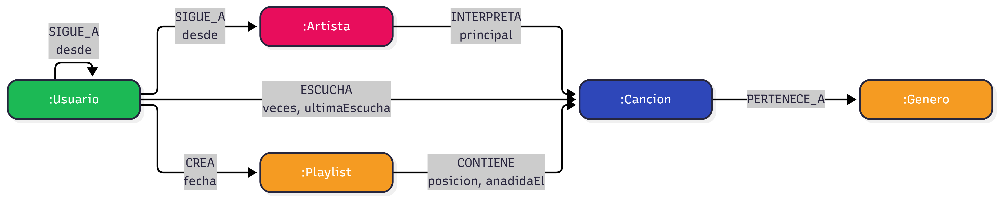

### 2.1 Etiquetas y propiedades

| Etiqueta | Obligatorias | Opcionales |
|---|---|---|
| `:Usuario` | `id`, `alias`, `fechaAlta` (Date), `historialPublico` (Boolean) | `pais` |
| `:Artista` | `id`, `nombre` | `pais` |
| `:Cancion` | `id`, `titulo`, `duracionSeg` (Integer) | `anio` (Integer) |
| `:Genero` | `id`, `nombre` | — |
| `:Playlist` | `id`, `nombre`, `publica` (Boolean) | — |

### 2.2 Relaciones

| Relación | Dirección | Propiedades (* obligatoria) | Preguntas |
|---|---|---|---|
| `SIGUE_A` | Usuario → Usuario | `desde` (Date) | 1, 6 |
| `SIGUE_A` | Usuario → Artista | `desde` (Date) | 1, 6 |
| `ESCUCHA` | Usuario → Cancion | `veces`* (Integer), `ultimaEscucha`* (DateTime) | Escrituras |
| `CREA` | Usuario → Playlist | `fecha` (Date) | 5 |
| `CONTIENE` | Playlist → Cancion | `posicion`* (Integer), `anadidaEl` (Date) | 5 |
| `INTERPRETA` | Artista → Cancion | `principal`* (Boolean) | 2, 3, 4, 7 |
| `PERTENECE_A` | Cancion → Genero | — | 2, 3 |

Cada relación va de quien actúa hacia lo que recibe la acción. `SIGUE_A` tiene dirección porque seguir no es mutuo: que un usuario siga a otro no significa que el otro le siga a él.

### 2.3 Nodo o propiedad

- **Artista → nodo.** Una canción puede tener dos artistas (pregunta 4), y como texto no se podrían enlazar.
- **Género → nodo.** Lo comparten muchas canciones. Así permite encontrar artistas del mismo género (pregunta 3) y evita duplicados como "Rock" y "rock".
- **Playlist → nodo.** Tiene datos propios y guarda canciones en orden (pregunta 5).
- **Colaboración → no se guarda aparte.** Se deduce cuando dos artistas `INTERPRETA` la misma canción. Encadenando colaboraciones se calcula el camino más corto entre artistas (pregunta 7).
- **`veces`, `posicion`, `principal` → propiedades de relación.** Describen el vínculo entre dos nodos, no a uno solo. Por ejemplo, la misma canción puede estar en la posición 1 de una playlist y en la 5 de otra.
- **`titulo`, `duracionSeg`, `pais` → propiedades de nodo.** Solo describen, y ninguna pregunta pasa por ellas.

**Regla:** si hay que pasar por un dato para llegar a otros, es nodo. Si solo se lee, es propiedad.

### 2.4 Identificadores y tipos

- **Identificador:** `id` de texto con prefijo (`u001`, `a001`, `c001`, `g01`, `p001`). Es único gracias a las restricciones del punto 3.
- **Id interno:** no se usa el id interno de Neo4j, porque puede reutilizarse cuando se borran nodos.
- **Carga:** los datos se cargan con `MERGE` por `id`, para no duplicar.
- **Tipos usados:** String, Integer, Boolean, Date y DateTime.
- **Nombres:** sin tildes ni espacios. Etiquetas en `PascalCase`, relaciones en `MAYUSCULAS`, propiedades en `camelCase`.

### 2.5 Límites y riesgos

**Supernodos:** los géneros grandes y las canciones muy escuchadas. Para evitarlos:
- Empezar siempre por un usuario o un artista concreto.
- Usar una sola relación `ESCUCHA` con contador.
- Limitar los saltos (`*1..3`) y los resultados (`LIMIT`).

**Operaciones no recomendables en un grafo:**
- **Caminos sin límite de saltos:** el número de caminos se dispara.
- **Estadísticas globales de toda la plataforma** (por ejemplo, reproducciones totales al mes): van mejor en un sistema analítico.
- **Guardar audio o imágenes:** solo se guarda su URL.

---

## 3. Restricciones, índices y carga de datos

### 3.1 Restricciones de unicidad
Impiden que haya dos nodos del mismo tipo con el mismo `id`. Cada restricción crea además un índice sobre ese `id`.

```cypher
CREATE CONSTRAINT usuario_id IF NOT EXISTS FOR (u:Usuario) REQUIRE u.id IS UNIQUE;
CREATE CONSTRAINT artista_id IF NOT EXISTS FOR (a:Artista) REQUIRE a.id IS UNIQUE;
CREATE CONSTRAINT cancion_id IF NOT EXISTS FOR (c:Cancion) REQUIRE c.id IS UNIQUE;
CREATE CONSTRAINT genero_id IF NOT EXISTS FOR (g:Genero) REQUIRE g.id IS UNIQUE;
CREATE CONSTRAINT playlist_id IF NOT EXISTS FOR (p:Playlist) REQUIRE p.id IS UNIQUE;
CREATE CONSTRAINT genero_nombre IF NOT EXISTS FOR (g:Genero) REQUIRE g.nombre IS UNIQUE;
```

Comprobación: `SHOW CONSTRAINTS;`

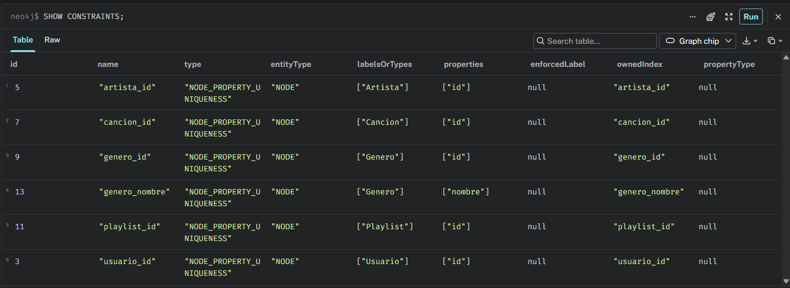

### 3.2 Índices secundarios
Sirven para encontrar al instante el nodo por el que empieza una búsqueda, sin revisar todos los nodos.

```cypher
// Buscar artista por nombre (las preguntas 2, 3, 4 y 7 empiezan por un artista)
CREATE INDEX artista_nombre IF NOT EXISTS FOR (a:Artista) ON (a.nombre);
// Buscar usuario por alias (preguntas 1 y 6)
CREATE INDEX usuario_alias IF NOT EXISTS FOR (u:Usuario) ON (u.alias);
// Buscar canción por título desde el buscador (pregunta 5)
CREATE INDEX cancion_titulo IF NOT EXISTS FOR (c:Cancion) ON (c.titulo);
```

Comprobación: `SHOW INDEXES;`

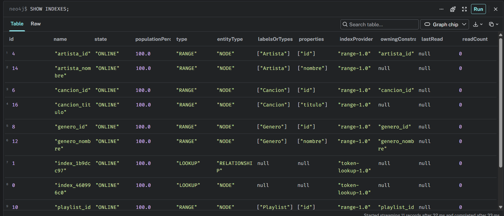

### 3.3 Carga de datos con MERGE
Se usa `MERGE` por `id` en lugar de `CREATE`: si el nodo o la relación ya existe, no se duplica. Las propiedades se asignan con `SET`. Cada relación busca sus dos nodos por `id` con `MATCH`, así que el script funciona aunque se ejecute por partes. Todos los datos son inventados. Total: **31 nodos y 72 relaciones**.

```cypher
// 1. Géneros (4)
UNWIND [
  {id:'g01', nombre:'Pop'}, {id:'g02', nombre:'Rock'},
  {id:'g03', nombre:'Urbano'}, {id:'g04', nombre:'Indie'}
] AS d
MERGE (g:Genero {id: d.id}) SET g.nombre = d.nombre;

// 2. Artistas (6)
UNWIND [
  {id:'a001', nombre:'Nova Ruiz', pais:'ES'},
  {id:'a002', nombre:'Los Faros', pais:'ES'},
  {id:'a003', nombre:'Kira Sol', pais:'MX'},
  {id:'a004', nombre:'DJ Marea', pais:'AR'},
  {id:'a005', nombre:'Brisa Norte', pais:'ES'},
  {id:'a006', nombre:'Teo Vance', pais:'CO'}
] AS d
MERGE (a:Artista {id: d.id}) SET a.nombre = d.nombre, a.pais = d.pais;

// 3. Canciones (12) y su género (12 PERTENECE_A)
UNWIND [
  {id:'c001', titulo:'Luz de Neon', duracion:198, anio:2023, genero:'g01'},
  {id:'c002', titulo:'Calle Mayor', duracion:185, anio:2024, genero:'g03'},
  {id:'c003', titulo:'Ruido Blanco', duracion:240, anio:2022, genero:'g02'},
  {id:'c004', titulo:'Marea Alta', duracion:201, anio:2024, genero:'g03'},
  {id:'c005', titulo:'Papel Mojado', duracion:215, anio:2021, genero:'g04'},
  {id:'c006', titulo:'Sol de Invierno', duracion:192, anio:2023, genero:'g01'},
  {id:'c007', titulo:'Ecos', duracion:230, anio:2024, genero:'g04'},
  {id:'c008', titulo:'Fuego Lento', duracion:176, anio:2025, genero:'g03'},
  {id:'c009', titulo:'Cielo Roto', duracion:205, anio:2025, genero:'g01'},
  {id:'c010', titulo:'Kilometro Cero', duracion:222, anio:2023, genero:'g02'},
  {id:'c011', titulo:'Noches de Radio', duracion:199, anio:2024, genero:'g01'},
  {id:'c012', titulo:'Ventana', duracion:187, anio:2022, genero:'g04'}
] AS d
MERGE (c:Cancion {id: d.id})
SET c.titulo = d.titulo, c.duracionSeg = d.duracion, c.anio = d.anio
WITH c, d
MATCH (g:Genero {id: d.genero})
MERGE (c)-[:PERTENECE_A]->(g);

// 4. Quién interpreta cada canción (17 INTERPRETA). principal=false → featuring
UNWIND [
  {a:'a001', c:'c001', p:true},  {a:'a001', c:'c002', p:true},  {a:'a004', c:'c002', p:false},
  {a:'a002', c:'c003', p:true},  {a:'a004', c:'c004', p:true},  {a:'a006', c:'c004', p:false},
  {a:'a005', c:'c005', p:true},  {a:'a002', c:'c005', p:false}, {a:'a003', c:'c006', p:true},
  {a:'a002', c:'c007', p:true},  {a:'a003', c:'c007', p:false}, {a:'a006', c:'c008', p:true},
  {a:'a001', c:'c009', p:true},  {a:'a002', c:'c010', p:true},  {a:'a003', c:'c011', p:true},
  {a:'a006', c:'c011', p:false}, {a:'a005', c:'c012', p:true}
] AS r
MATCH (a:Artista {id: r.a})
MATCH (c:Cancion {id: r.c})
MERGE (a)-[i:INTERPRETA]->(c) SET i.principal = r.p;

// 5. Usuarios (6)
UNWIND [
  {id:'u001', alias:'luna_beats', alta:'2025-01-10', pub:true, pais:'ES'},
  {id:'u002', alias:'vinilo_azul', alta:'2025-02-14', pub:true, pais:'ES'},
  {id:'u003', alias:'lofi_nocturno', alta:'2025-03-02', pub:true, pais:'MX'},
  {id:'u004', alias:'riff_del_sur', alta:'2025-03-20', pub:false, pais:'ES'},
  {id:'u005', alias:'synth_wave', alta:'2025-04-11', pub:true, pais:'AR'},
  {id:'u006', alias:'modo_aleatorio', alta:'2025-05-05', pub:true, pais:'ES'}
] AS d
MERGE (u:Usuario {id: d.id})
SET u.alias = d.alias, u.fechaAlta = date(d.alta),
    u.historialPublico = d.pub, u.pais = d.pais;

// 6. Usuario sigue a usuario (7 SIGUE_A)
UNWIND [
  ['u001','u002','2025-02-20'], ['u001','u003','2025-03-05'], ['u002','u001','2025-02-21'],
  ['u002','u004','2025-04-01'], ['u003','u005','2025-04-15'], ['u004','u006','2025-05-10'],
  ['u005','u001','2025-05-12']
] AS r
MATCH (a:Usuario {id: r[0]})
MATCH (b:Usuario {id: r[1]})
MERGE (a)-[s:SIGUE_A]->(b) SET s.desde = date(r[2]);

// 7. Usuario sigue a artista (7 SIGUE_A)
UNWIND [
  ['u001','a001','2025-01-15'], ['u002','a003','2025-02-18'], ['u003','a003','2025-03-10'],
  ['u003','a006','2025-03-12'], ['u004','a002','2025-03-25'], ['u005','a004','2025-04-20'],
  ['u006','a005','2025-05-08']
] AS r
MATCH (u:Usuario {id: r[0]})
MATCH (a:Artista {id: r[1]})
MERGE (u)-[s:SIGUE_A]->(a) SET s.desde = date(r[2]);

// 8. Escuchas (17 ESCUCHA): una relación por usuario y canción, con contador
UNWIND [
  ['u001','c001',25,'2026-10-20T18:30:00'], ['u001','c002',12,'2026-10-18T09:15:00'],
  ['u001','c009',8,'2026-10-22T22:05:00'],  ['u002','c006',30,'2026-10-21T17:40:00'],
  ['u002','c011',14,'2026-10-19T20:10:00'], ['u002','c003',5,'2026-10-10T12:00:00'],
  ['u003','c006',18,'2026-10-23T08:45:00'], ['u003','c007',22,'2026-10-24T23:30:00'],
  ['u003','c004',9,'2026-10-15T19:20:00'],  ['u004','c003',40,'2026-10-25T16:00:00'],
  ['u004','c010',17,'2026-10-22T11:35:00'], ['u005','c002',11,'2026-10-20T21:50:00'],
  ['u005','c004',27,'2026-10-24T18:05:00'], ['u005','c008',15,'2026-10-21T10:25:00'],
  ['u006','c005',33,'2026-10-25T09:00:00'], ['u006','c012',21,'2026-10-23T14:15:00'],
  ['u006','c007',6,'2026-10-12T20:40:00']
] AS r
MATCH (u:Usuario {id: r[0]})
MATCH (c:Cancion {id: r[1]})
MERGE (u)-[e:ESCUCHA]->(c)
SET e.veces = r[2], e.ultimaEscucha = datetime(r[3]);

// 9. Playlists (3) y quién las crea (3 CREA)
UNWIND [
  {id:'p001', nombre:'Para correr', pub:true, user:'u001', fecha:'2025-06-01'},
  {id:'p002', nombre:'Tardes tranquilas', pub:true, user:'u003', fecha:'2025-06-15'},
  {id:'p003', nombre:'Solo indie', pub:false, user:'u006', fecha:'2025-07-02'}
] AS d
MERGE (p:Playlist {id: d.id}) SET p.nombre = d.nombre, p.publica = d.pub
WITH p, d
MATCH (u:Usuario {id: d.user})
MERGE (u)-[cr:CREA]->(p) SET cr.fecha = date(d.fecha);

// 10. Canciones de cada playlist (9 CONTIENE)
UNWIND [
  ['p001','c002',1,'2025-06-01'], ['p001','c004',2,'2025-06-01'], ['p001','c008',3,'2025-06-03'],
  ['p002','c006',1,'2025-06-15'], ['p002','c007',2,'2025-06-15'], ['p002','c012',3,'2025-06-20'],
  ['p003','c005',1,'2025-07-02'], ['p003','c012',2,'2025-07-02'], ['p003','c007',3,'2025-07-05']
] AS r
MATCH (p:Playlist {id: r[0]})
MATCH (c:Cancion {id: r[1]})
MERGE (p)-[ct:CONTIENE]->(c)
SET ct.posicion = r[2], ct.anadidaEl = date(r[3]);
```

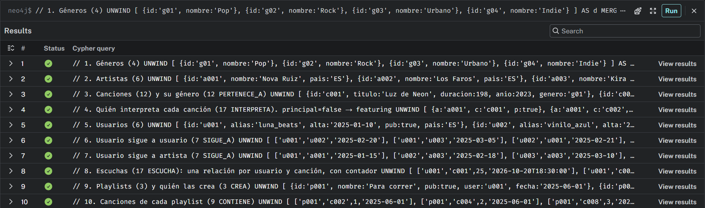

### 3.4 Comprobación del dataset

```cypher
// Nodos por etiqueta (esperado: Artista 6, Cancion 12, Genero 4, Playlist 3, Usuario 6 → 31)
MATCH (n) RETURN labels(n)[0] AS etiqueta, count(*) AS total ORDER BY etiqueta;

// Relaciones por tipo (esperado: CONTIENE 9, CREA 3, ESCUCHA 17, INTERPRETA 17, PERTENECE_A 12, SIGUE_A 14 → 72)
MATCH ()-[r]->() RETURN type(r) AS relacion, count(*) AS total ORDER BY relacion;

// Grafo completo
MATCH (n)-[r]->(m) RETURN n, r, m;
```

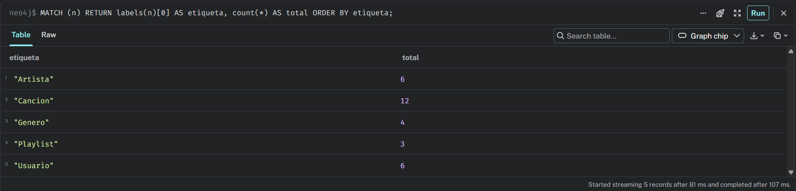
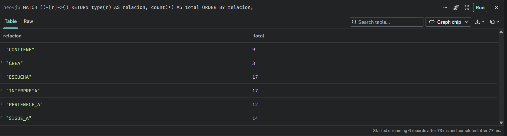
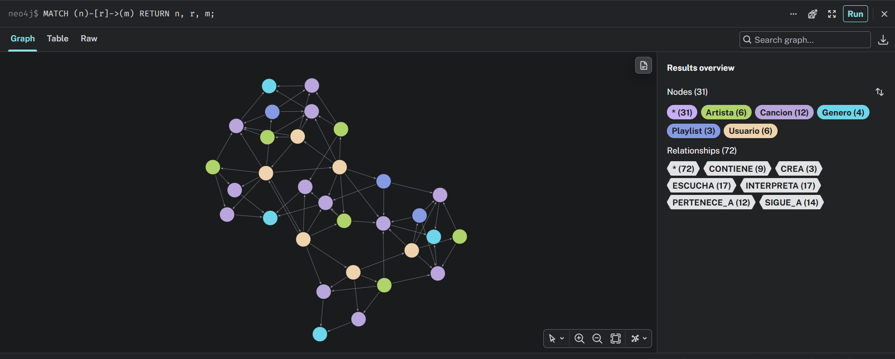

### 3.5 Idempotencia y prueba de unicidad
Tras ejecutar la carga dos veces seguidas, el número de nodos y relaciones no cambia: el script es idempotente.

```cypher
MATCH (n) WITH count(n) AS nodos
MATCH ()-[r]->() RETURN nodos, count(r) AS relaciones;
```

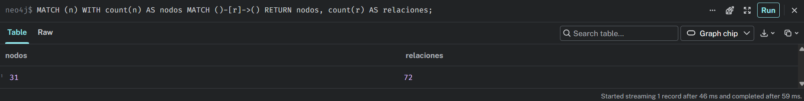

Al intentar crear un usuario con un `id` que ya existe, Neo4j lo rechaza gracias a la restricción de unicidad:

```cypher
CREATE (:Usuario {id:'u001', alias:'duplicado', fechaAlta:date(), historialPublico:true});
```

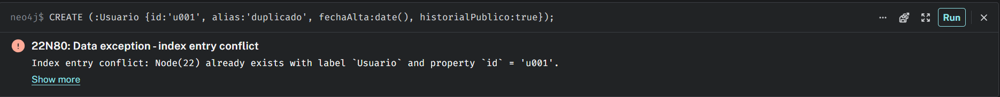

### 3.6 Plan de ejecución con PROFILE
Con índice, Neo4j va directo al artista (**NodeIndexSeek**). Sin índice, revisa todas las canciones una a una (**NodeByLabelScan**).

```cypher
// Con índice
PROFILE MATCH (a:Artista {nombre:'Nova Ruiz'})-[:INTERPRETA]->(c:Cancion)
RETURN a.nombre, c.titulo;

// Sin índice (comparación)
PROFILE MATCH (c:Cancion) WHERE c.duracionSeg > 200
RETURN c.titulo, c.duracionSeg;
```

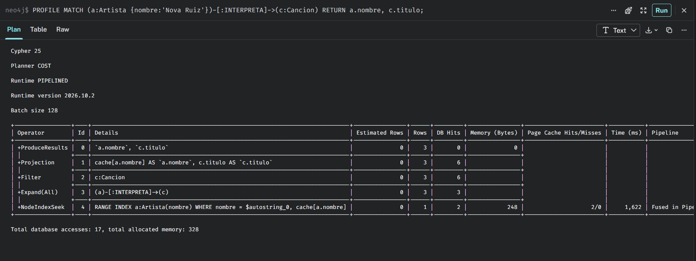
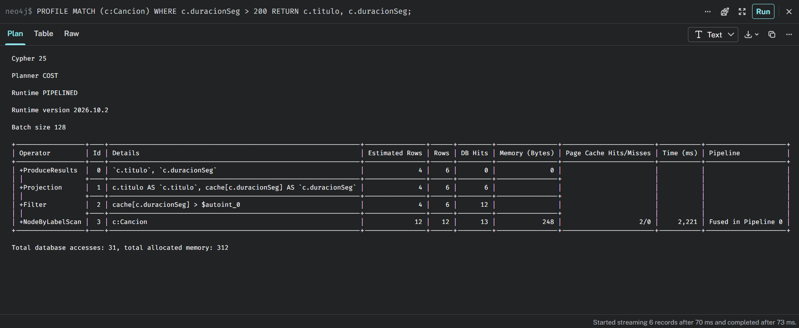

| Consulta | Primer operador | Filas que revisa | Accesos totales |
|---|---|---|---|
| Con índice (`Artista.nombre`) | NodeIndexSeek | 1 | 17 |
| Sin índice (`duracionSeg`) | NodeByLabelScan | 12 (todas las canciones) | 31 |

Con índice, Neo4j revisa solo el artista que busca. Sin índice, revisa las 12 canciones, y con millones de canciones esa diferencia sería enorme.

---

## 4. Consultas Cypher y recorridos

Todas las consultas empiezan por un dato con índice (`nombre` del artista, `alias` del usuario o `titulo` de la canción), así que Neo4j encuentra el punto de partida al instante.

### 4.1 Operación básica: crear y actualizar con MERGE y SET

**a) Un artista sube una canción nueva** (crea el nodo y sus relaciones)

```cypher
// Si la canción ya existe, MERGE la encuentra por su id y no la duplica
MATCH (a:Artista {nombre: 'Kira Sol'})
MATCH (g:Genero {nombre: 'Pop'})
MERGE (c:Cancion {id: 'c013'})
SET c.titulo = 'Brillo Nuevo', c.duracionSeg = 210, c.anio = 2026
MERGE (a)-[i:INTERPRETA]->(c)
SET i.principal = true
MERGE (c)-[:PERTENECE_A]->(g)
RETURN a.nombre AS artista, c.titulo AS cancion, g.nombre AS genero;
```

**Resultado:** Kira Sol | Brillo Nuevo | Pop

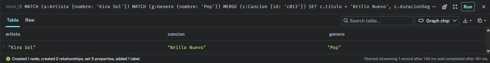

**b) Pregunta 5: añadir una canción a mi playlist en una posición concreta**

```cypher
// La playlist solo se encuentra si la ha creado este usuario (relación CREA)
MATCH (u:Usuario {alias: 'luna_beats'})-[:CREA]->(p:Playlist {nombre: 'Para correr'})
MATCH (c:Cancion {titulo: 'Cielo Roto'})
MERGE (p)-[ct:CONTIENE]->(c)
ON CREATE SET ct.anadidaEl = date()
SET ct.posicion = 4
RETURN p.nombre AS playlist, c.titulo AS cancion, ct.posicion AS posicion;

// Comprobación: canciones de la playlist en orden
MATCH (p:Playlist {nombre: 'Para correr'})-[ct:CONTIENE]->(c:Cancion)
RETURN ct.posicion AS posicion, c.titulo AS cancion
ORDER BY posicion;
```

**Resultado:** 1 Calle Mayor · 2 Marea Alta · 3 Fuego Lento · 4 Cielo Roto

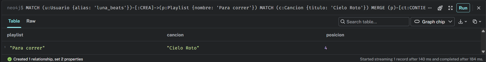
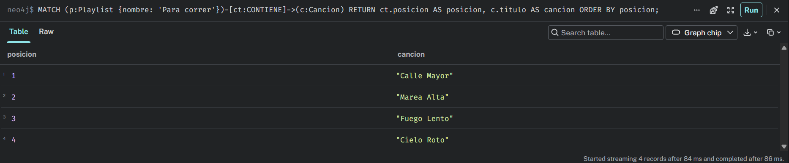

**c) Registrar una escucha (suma 1 al contador)**

```cypher
MATCH (u:Usuario {alias: 'luna_beats'})
MATCH (c:Cancion {titulo: 'Sol de Invierno'})
MERGE (u)-[e:ESCUCHA]->(c)
ON CREATE SET e.veces = 1
ON MATCH SET e.veces = e.veces + 1
SET e.ultimaEscucha = datetime()
RETURN u.alias AS usuario, c.titulo AS cancion, e.veces AS veces;
```

**Resultado:** la primera vez `veces = 1` y la segunda `veces = 2`. Nunca se crea una segunda relación.

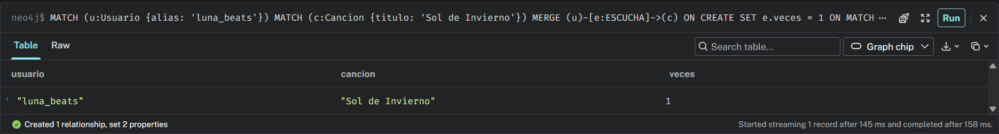
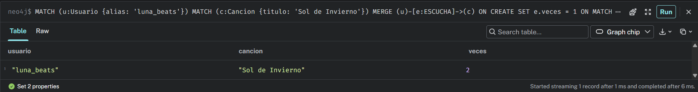

### 4.2 Consulta de 1 salto – Pregunta 1: ¿A qué usuarios y artistas sigo?

```cypher
MATCH (yo:Usuario {alias: 'luna_beats'})-[s:SIGUE_A]->(x)
RETURN labels(x)[0] AS tipo,
       coalesce(x.alias, x.nombre) AS nombre,
       s.desde AS desde
ORDER BY desde;
```

**Resultado:** Artista Nova Ruiz (2025-01-15) · Usuario vinilo_azul (2025-02-20) · Usuario lofi_nocturno (2025-03-05)

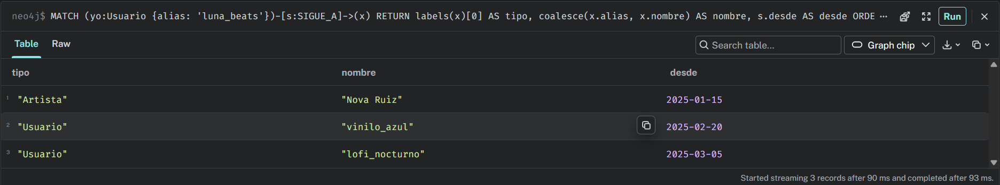

### 4.3 Consultas de varios saltos

**Pregunta 2: canciones de un artista de un género concreto, ordenadas por año**

```cypher
MATCH (a:Artista {nombre: 'Nova Ruiz'})-[:INTERPRETA]->(c:Cancion)-[:PERTENECE_A]->(g:Genero)
WHERE g.nombre = 'Pop'
RETURN c.titulo AS cancion, c.anio AS anio, c.duracionSeg AS duracion
ORDER BY anio;
```

**Resultado:** Luz de Neon (2023) · Cielo Roto (2025). Calle Mayor no aparece porque es del género Urbano.

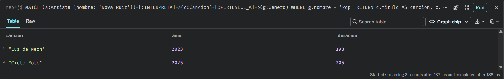

**Pregunta 6: usuarios que sigo que también siguen a un artista**

```cypher
MATCH (yo:Usuario {alias: 'luna_beats'})-[:SIGUE_A]->(amigo:Usuario)-[:SIGUE_A]->(a:Artista {nombre: 'Kira Sol'})
RETURN amigo.alias AS amigo, a.nombre AS artista
ORDER BY amigo;
```

**Resultado:** lofi_nocturno · vinilo_azul

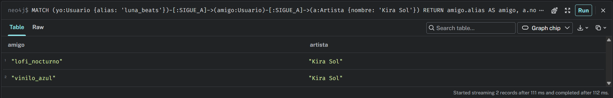

### 4.4 Recomendación por afinidad

**Pregunta 3: artistas que hacen el mismo género que yo**

```cypher
MATCH (yo:Artista {nombre: 'Nova Ruiz'})-[:INTERPRETA]->(:Cancion)-[:PERTENECE_A]->(g:Genero)
      <-[:PERTENECE_A]-(:Cancion)<-[:INTERPRETA]-(otro:Artista)
WHERE otro <> yo
RETURN otro.nombre AS artista,
       collect(DISTINCT g.nombre) AS generos_en_comun,
       count(DISTINCT g) AS total
ORDER BY total DESC, artista;
```

**Resultado:** Teo Vance (Pop y Urbano, 2) · DJ Marea (Urbano, 1) · Kira Sol (Pop, 1). Teo Vance es el más afín porque comparte los dos géneros de Nova Ruiz.

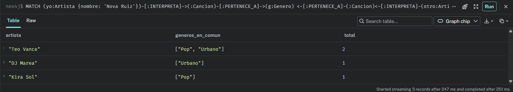

**Pregunta 4: con qué artistas he colaborado y en qué canciones**

```cypher
MATCH (yo:Artista {nombre: 'Kira Sol'})-[:INTERPRETA]->(c:Cancion)<-[:INTERPRETA]-(otro:Artista)
WHERE otro <> yo
RETURN otro.nombre AS colaborador,
       collect(c.titulo) AS canciones,
       count(c) AS total
ORDER BY total DESC, colaborador;
```

**Resultado:** Los Faros (Ecos) · Teo Vance (Noches de Radio)

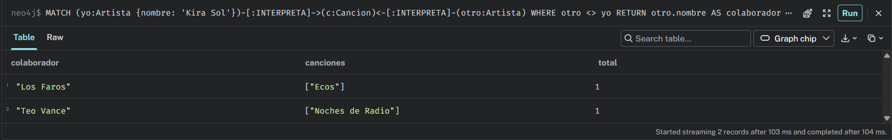

### 4.5 Camino más corto – Pregunta 7

¿Cómo está conectada Nova Ruiz con Brisa Norte, con quien nunca ha colaborado?

```cypher
MATCH (a1:Artista {nombre: 'Nova Ruiz'})
MATCH (a2:Artista {nombre: 'Brisa Norte'})
MATCH camino = shortestPath((a1)-[:INTERPRETA*..12]-(a2))
RETURN [n IN nodes(camino) | coalesce(n.nombre, n.titulo)] AS cadena,
       length(camino) / 2 AS grados_de_separacion;
```

**Resultado:** Nova Ruiz → Calle Mayor → DJ Marea → Marea Alta → Teo Vance → Noches de Radio → Kira Sol → Ecos → Los Faros → Papel Mojado → Brisa Norte. **5 grados de separación.**

Cada grado son 2 saltos (artista → canción → artista). El límite de 12 saltos (6 grados) evita que la búsqueda se dispare.

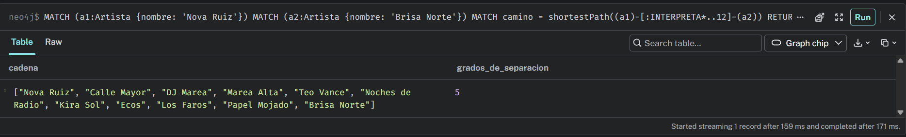

Para verlo como grafo, cambia la última parte por `RETURN camino;`

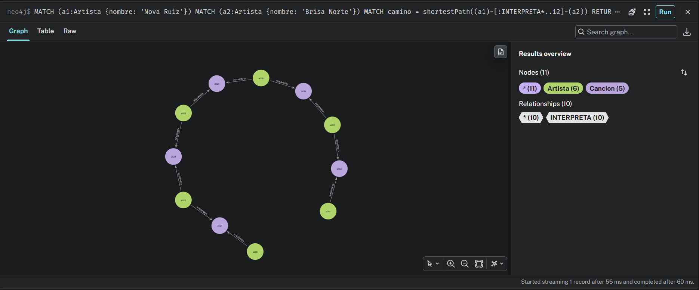

### 4.6 ¿Por qué Neo4j resuelve estos caminos en milisegundos?

En una base de datos relacional, cada vez que se salta de una tabla a otra (un `JOIN`) hay que buscar las filas que coinciden, normalmente en un índice. Cuantas más filas tiene la tabla, más cuesta cada búsqueda, y en una consulta con muchos saltos ese coste se repite en cada `JOIN`.

En Neo4j cada nodo guarda la dirección directa de sus relaciones, como si cada artista llevara en el bolsillo la lista de sus canciones. Saltar a un vecino es seguir esa dirección, sin buscar nada. A esto se le llama **adyacencia libre de índices**. El índice solo se usa una vez, para encontrar el nodo de inicio. A partir de ahí, el coste depende de la parte del grafo que se recorre, no del tamaño total de la base de datos.

---

## 5. Comparación técnica, seguridad y copias

### 5.1 Comparativa: pregunta 3 (afinidad) en SQL y en Neo4j

En un modelo relacional harían falta las tablas `artistas`, `canciones` (con `genero_id`), `generos` y la tabla intermedia `interpreta` (`artista_id`, `cancion_id`).

```sql
SELECT a2.nombre, g.nombre AS genero
FROM artistas a1
JOIN interpreta i1 ON i1.artista_id = a1.id
JOIN canciones  c1 ON c1.id = i1.cancion_id
JOIN generos    g  ON g.id = c1.genero_id
JOIN canciones  c2 ON c2.genero_id = g.id
JOIN interpreta i2 ON i2.cancion_id = c2.id
JOIN artistas   a2 ON a2.id = i2.artista_id
WHERE a1.nombre = 'Nova Ruiz' AND a2.id <> a1.id
GROUP BY a2.nombre, g.nombre;
```

| Criterio | Neo4j | SQL |
|---|---|---|
| Uniones | Ninguna: un único patrón de 4 relaciones | 6 `JOIN` |
| Cómo trabaja | Sigue las conexiones desde Nova Ruiz | Busca en índices en cada `JOIN` y cruza dos veces la tabla intermedia |
| De qué depende el coste | De los vecinos de Nova Ruiz | Del tamaño de las tablas, sobre todo `interpreta` y `canciones` |
| Legibilidad | El patrón dibuja el recorrido | Larga y difícil de mantener |

La pregunta 7 (camino más corto) es aún peor en SQL. Necesita una consulta recursiva (`WITH RECURSIVE`), y cada grado de separación añade dos `JOIN` más. En Neo4j es una sola línea con `shortestPath`.

### 5.2 Copias de seguridad y restauración

El volcado se hace con la base de datos **parada**.

```bash
# 1. Parar la instancia en Neo4j Desktop (botón Stop) y abrir su terminal

# 2. Crear la carpeta y hacer el volcado (crea el archivo neo4j.dump)
mkdir backups
.\bin\neo4j-admin.bat database dump neo4j --to-path=backups

# 3. Restaurar desde el volcado (también con la instancia parada)
.\bin\neo4j-admin.bat database load neo4j --from-path=backups --overwrite-destination=true

# 4. Arrancar de nuevo (Start) y comprobar con los recuentos del apartado 3.4
```

En Neo4j Aura, las copias se gestionan desde la consola de la instancia, y las opciones disponibles dependen del plan.

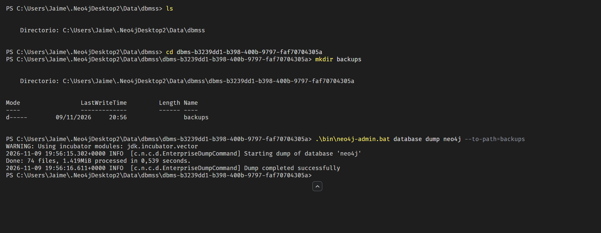
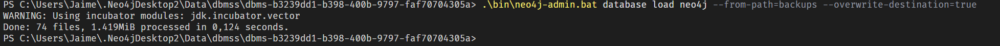

### 5.3 Seguridad y permisos (mínimo privilegio)

Se ejecuta sobre la base de datos `system`. Requiere la edición Enterprise, que incluye Neo4j Desktop. Las contraseñas son de ejemplo y se cambian en el primer acceso.

```cypher
// Ejecutar con la base de datos system seleccionada (:use system)

// Administrador: control total
CREATE USER admin_musica IF NOT EXISTS SET PASSWORD 'CAMBIAR_CLAVE_1' CHANGE REQUIRED;
GRANT ROLE admin TO admin_musica;

// App móvil: lee y escribe datos, pero no puede borrar ni cambiar la estructura
CREATE ROLE app_movil IF NOT EXISTS AS COPY OF editor;
DENY DELETE ON GRAPH neo4j NODES * TO app_movil;
DENY DELETE ON GRAPH neo4j RELATIONSHIPS * TO app_movil;
CREATE USER usuario_app IF NOT EXISTS SET PASSWORD 'CAMBIAR_CLAVE_2' CHANGE REQUIRED;
GRANT ROLE app_movil TO usuario_app;

// Comprobación
SHOW USERS;
SHOW ROLE app_movil PRIVILEGES;
```

| Usuario | Rol | Puede | No puede |
|---|---|---|---|
| `admin_musica` | admin | Todo: datos, índices, restricciones y usuarios | — |
| `usuario_app` | app_movil | Leer y registrar escuchas, seguimientos y playlists | Borrar datos, crear índices o restricciones, gestionar usuarios |

Si la app solo tuviera que consultar datos, bastaría con `GRANT ROLE reader TO usuario_app;`.

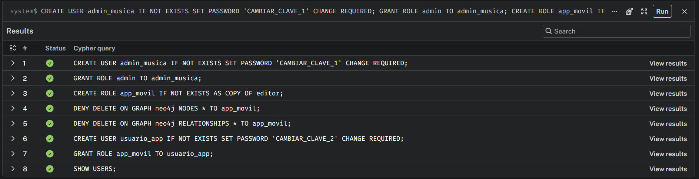
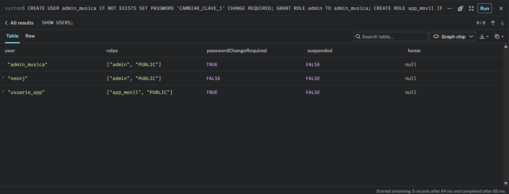
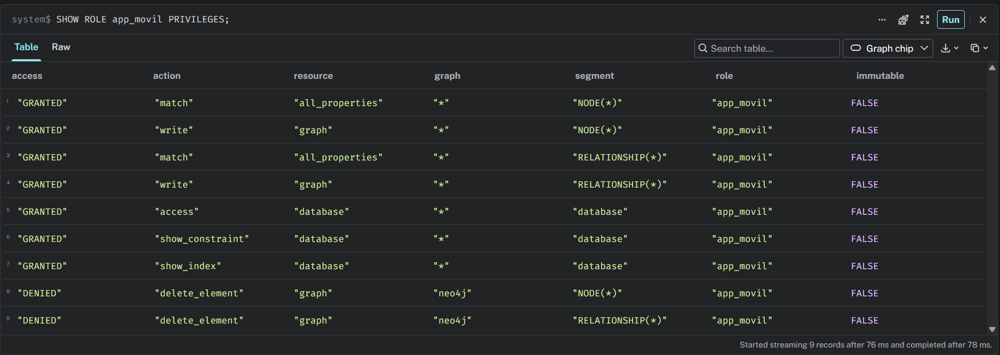

### 5.4 Cuándo NO usar Neo4j

1. **Facturación de suscripciones → base de datos relacional (PostgreSQL).** Los pagos tienen siempre la misma estructura (usuario, plan, importe, fecha) y se usan para sumas y totales por mes. No hay que recorrer conexiones, y SQL resuelve mejor los informes contables y las transacciones de dinero.
2. **Ficha completa de cada canción → base de datos documental (MongoDB).** La letra, los créditos, las versiones por país o los enlaces cambian mucho de una canción a otra. Se leen de golpe para mostrar la ficha, sin navegar a otros datos, así que un documento flexible es más práctico que muchos nodos y propiedades.

---

## 6. Revisión final

- [x] Base de datos vaciada con `MATCH (n) DETACH DELETE n;`
- [x] Bloques 3.1, 3.2 y 3.3 ejecutados en orden y sin errores.
- [x] Recuentos correctos: 31 nodos y 72 relaciones.
- [x] Las consultas del punto 4 devuelven los resultados indicados.
- [x] Sin credenciales reales ni datos personales reales.
- [x] Todas las capturas están guardadas en `evidencias/`.

Tras vaciar la base de datos y ejecutar de nuevo 3.1, 3.2 y 3.3, el recuento vuelve a dar 31 nodos y 72 relaciones:

```cypher
MATCH (n) WITH count(n) AS nodos
MATCH ()-[r]->() RETURN nodos, count(r) AS relaciones;
```

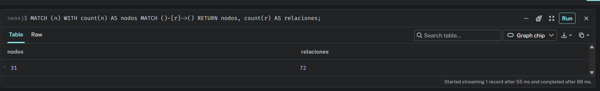